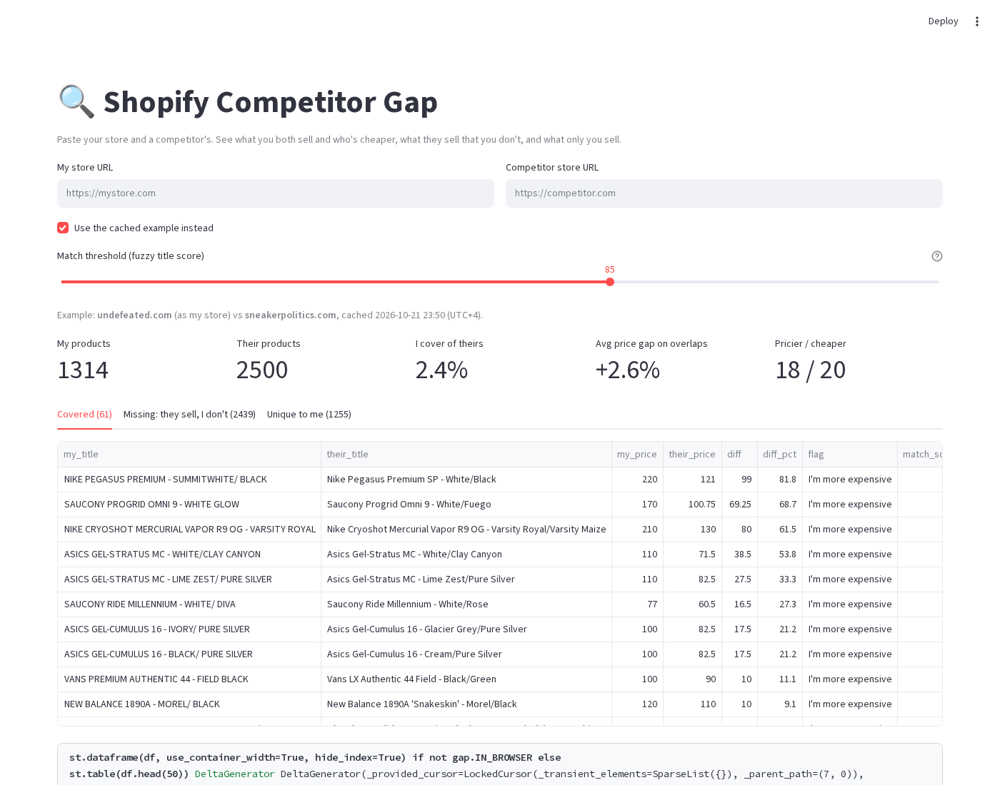

# 🔍 Shopify Competitor Gap

**[▶ Live demo](https://madebysid.github.io/shopify-competitor-gap/)**: a real cached comparison that runs in your browser (first load takes ~30s).



## The problem
Ecommerce teams check competitors by hand: open their store, scroll, guess what overlaps and who's cheaper. That doesn't scale past a few dozen products, and the useful questions stay unanswered:
- Which of their products do I already sell, and am I more expensive?
- What do they sell that I don't? That list is my range opportunity.
- What only I sell, so I can lean on it?

Paste two Shopify store URLs and get all three answers, with CSVs, in under a minute.

## Real example (cached in the demo)
undefeated.com (as "my store") vs sneakerpolitics.com, pulled Oct 21, 2026 at the default threshold of 85:

| My products | Their products | Covered | Missing | Unique to me | I cover of theirs | Avg gap on overlaps | Pricier / cheaper |
|---|---|---|---|---|---|---|---|
| 1,314 | 2,500* | 61 | 2,439 | 1,255 | 2.4% | +2.6% | 18 / 20 (23 same price) |

\*Capped at 10 pages × 250 products.

## Features
- Pulls both full catalogues from `/products.json`, paginated (250 per page, 10 pages by default). Price = lowest variant price.
- Matching: same handle first, else a fuzzy title score (rapidfuzz `token_sort_ratio`) within the same vendor and size group (kids tags like PS/TD/GS and women's must agree, so adult shoes don't match kids' sizes). There's a **threshold slider** for how strict it is.
- **Covered**: my price, their price, the difference, the % difference, and an "I'm more expensive / I'm cheaper" flag.
- **Missing**: what they sell and I don't, most expensive first.
- **Unique to me**.
- Summary metrics and a CSV download for each view.

## Setup
```bash
pip install -r requirements.txt
streamlit run app.py
```

## How it works
1. `gap.fetch_catalogue(url)` reads `<store>/products.json?limit=250&page=N` until a page comes back short.
2. `gap.match_catalogues(mine, theirs, threshold)` finds the best match in my catalogue for each competitor product.
3. `gap.summary(...)` calculates coverage (the share of their products I match) and the average % price gap.
4. `app.py` shows the metrics, three tabs and CSV links.

Tests: `pip install pytest && pytest -q`

## Limitations
- Only works on Shopify stores that expose `/products.json`. Some stores block it.
- It compares list prices in each store's own currency, with no currency conversion.
- Prices are current list prices, so a competitor's sale price shows up as a big gap.
- Colourways and sizes listed as separate products may match one-to-many or miss. Use the slider and check the match score.
- The browser demo runs on Pyodide. Browsers block cross-site requests (CORS), so it shows only the cached example and uses a difflib matcher in place of rapidfuzz (same results on the example). `docs/` holds copies of `app.py` and `gap.py`.

## Author
Siddharth Kumar · [sidailab.com](https://sidailab.com) · MIT licensed. I built and ran a product engine at EcomVest that scraped competitor catalogues for our Shopify stores and took output from about 100 to about 1,000 products a week. This is a small, open tool from the same playbook.
